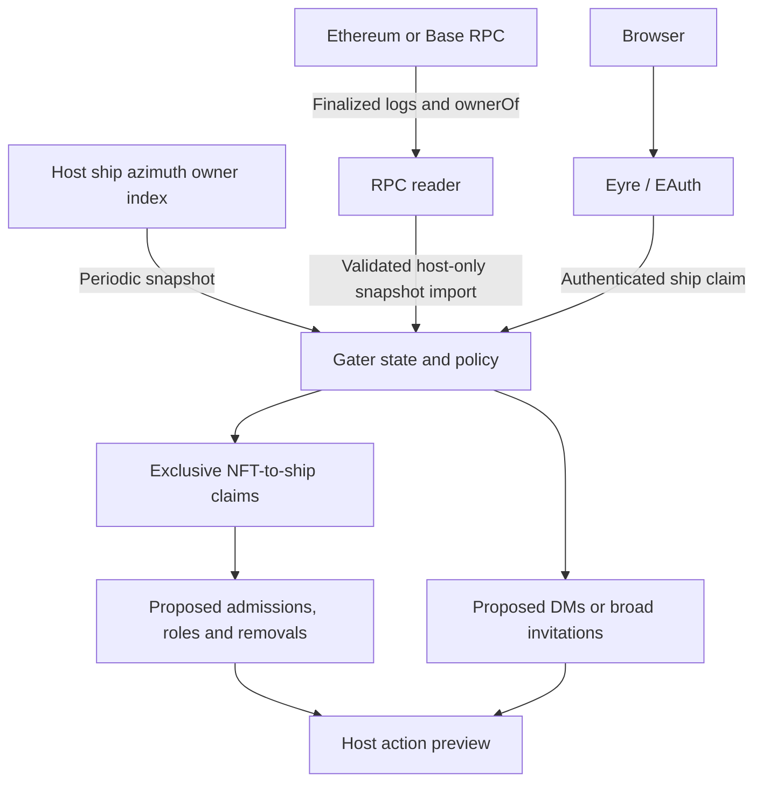

# Architecture

## First-pass data flow

The delivery adapter is deliberately absent in this version. A future Tlon adapter consumes decisions, observes actual group state, and records ownership of the effects it applies. A Gall poke ack alone will not count as successful admission or role assignment.

## State and invariants

`desk/sur/gater.hoon` defines collections, ship owners, NFT owners, exclusive claims, managed seats/roles, suppression, an effect queue, source observation times, checkpoints, and the state revision. Gall serializes updates. Claim/release requests include the state revision so simultaneous browser requests cannot both overwrite the same version.

An asset is `[collection-id token-id]`; its configuration fixes chain and contract. Token IDs are full uint256 values serialized as decimal strings. A ship must be an Azimuth-sized identity with the same nonzero address as the token owner. A claim records its owner so a changed owner invalidates it. Claiming first clears that ship's other token in the collection, then replaces the target token's association in the same transition.

Desired roles are unioned by group/ship across collections. Only roles tracked in Gater's `applied` map are considered for revocation; only `managed` seats are eligible for removal. A broad invite without a claim can retain membership while eligible; a lost claim removes its previously managed access by default. These maps currently serve the reducer and tests; populating them from observed Tlon state is unfinished.

The reconciliation queue is a **preview**, not an executed transaction log. Pending entries are rebuilt after state changes and on a minute timer. Their numeric IDs are not durable delivery idempotency keys. Production transport must introduce generation-scoped receipts, retries, bounded history, and removal-before-addition barriers. Never send the preview list blindly.

## Source trust

The native reader polls `%azimuth`'s `/own` map when the host enables it. This includes the ship's effective L2 ownership view. Observation time does not prove chain freshness or index completeness; there is no finalized Azimuth checkpoint certificate in this version. The app displays stale data after 15 minutes without observation.

The external ERC-721 reader verifies the chain, contract code and ERC-165 support, requests bounded Transfer-log ranges, replays mint/transfer/burn events, verifies discovered holders with `ownerOf`, and checks the finalized block hash again before writing output. It refuses missing finality, changed checkpoints, inconsistent logs and owner mismatches. Full replay is intentionally simple; large collections need incremental indexing before regular operation.

RPC snapshot import checks collection identity, observation age, increasing checkpoint height, and hash consistency at the same height. Snapshots are host-trusted inputs, not independently proved by the agent. A wrong deployment block, missing constructor/ERC-2309 mints, silently truncated provider results, or transfer-away-and-back between snapshots may evade this first index. This is why live delivery remains blocked. Use event generations and source provenance in the next version.

## HTTP boundary

The host serves `/gater`, static JS/CSS, `GET /gater/me`, and `POST /gater/action`. The page initiates `/~/login` EAuth. Eyre delivers the remote authenticated ship as `src.bowl`; its `authenticated` flag is true only for local host sessions. Anonymous Eyre identities are comet-sized, which the app rejects. This identity distinction is covered by unit tests; a real two-ship EAuth handshake remains to be tested.

Remote ships can only claim/release as themselves. Group/role/configuration and ownership input require the host identity. POSTs require a same-origin Origin/Host pair and `X-Gater: 1`. Responses are uncached; the page has a restrictive content security policy and inserts text with DOM `textContent`. There are no wallet or RPC credentials in the UI.

## Planned Tlon adapter

Translate operations in a version-pinned module. For admission, approve an existing request or create a role-bearing pending invite; for a present member, assign only the configured roles. On replacement, observe successful removal of the old managed roles/seat before granting the new one. On loss, also cancel pending admissions. Respect bans, host/channel-host protections, manual memberships and administrative roles. Persist intent before delivery, observe after delivery, and resume safely after crashes.
