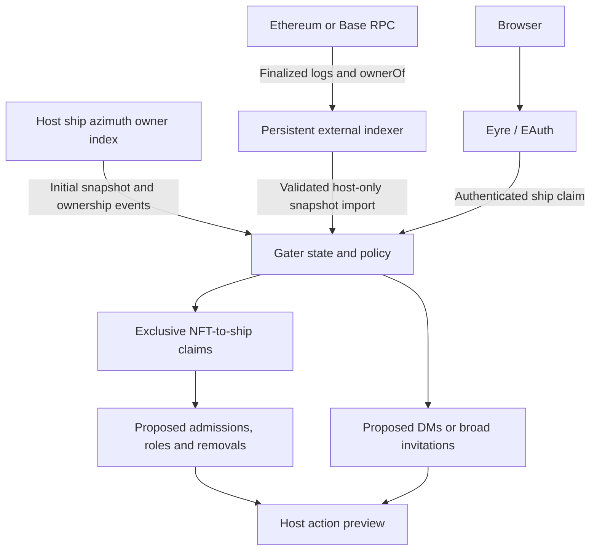

# Architecture

## First-pass data flow

The delivery adapter is deliberately absent in this version. A future Tlon adapter consumes decisions, observes actual group state, and records ownership of the effects it applies. A Gall poke ack alone will not count as successful admission or role assignment.

## State and invariants

`desk/sur/gater.hoon` defines collections, ship owners, NFT owners and transfer generations, exclusive claims, managed seats/roles, suppression, an effect queue, source health/epochs/coverage, observation times, checkpoints, and the state revision. Gall serializes updates. Claim/release requests include the state revision so simultaneous browser requests cannot both overwrite the same version. The explicit v0→v1 migration preserves fixture associations; legacy non-fixture claims lack provenance and require a new claim.

An asset is `[collection-id token-id]`; its configuration fixes chain and contract. Token IDs are full uint256 values serialized as decimal strings. A ship must be an Azimuth-sized identity with the same nonzero address as the token owner. A claim records its owner so a changed owner invalidates it. Ordinary claiming cannot displace another ship. The linked eligible ship can explicitly reassign its NFT to an eligible target with no other claim in that collection. A recipient can instead authorize takeover with the current owner wallet’s signature. Self-directed claims clear that ship’s previous token in the collection atomically, preserving one-to-one mapping.

Desired roles are unioned by group/ship across collections. Only roles tracked in Gater's `applied` map are considered for revocation; only `managed` seats are eligible for removal. A broad invite without a claim can retain membership while eligible; a lost claim removes its previously managed access by default. These maps currently serve the reducer and tests; populating them from observed Tlon state is unfinished.

The reconciliation queue is a **preview**, not an executed transaction log. Pending entries are rebuilt after state changes and on a minute timer. Their numeric IDs are not durable delivery idempotency keys. Production transport must introduce generation-scoped receipts, retries, bounded history, and removal-before-addition barriers. Never send the preview list blindly.

## Source trust

When enabled, the native adapter subscribes to `%azimuth`'s `/event`, receives its initial `%naive-state`, and consumes `%point ... %owner ...` differences. Its installed `%zuse 408` ownership map is keyed by `[proxy address]`; only `%own` entries are eligible. The adapter also checks `/own` once per minute. Observed ownership changes prune claims immediately, so transferring a ship away and back does not resurrect its old association. A fresh subscription or mismatched periodic snapshot cannot prove continuity across the gap: it clears claims and requires reassertion. Existing Gall subscriptions are retained across compatible agent reloads.

Native state includes effective L2 ownership, but observation time does not prove chain freshness or complete PKI coverage. `/event` strips the internal processed-block wrapper. A connected feed is therefore reported as *observed*, not finalized; live delivery remains gated on resolving this limitation. A missing/kicked subscription pauses claims while reconnecting. Ordinary observations expire after 15 minutes.

`scripts/index.py` is the supported external NFT worker. It verifies chain, bytecode and ERC-165 support and uses only `finalized`, never a fallback to `latest`. Bootstrap either enumerates all current tokens with ERC-721Enumerable or replays Transfer/ERC-2309 events from a reviewed deployment block. Event mode checks that code was absent immediately before deployment. Both modes require totalSupply agreement and validate every ownerOf at the pinned checkpoint. Enumeration can handle constructor mints with no logs; event-only contracts with incomplete mint coverage or no meaningful totalSupply need a separate adapter.

The worker atomically persists its cursor, owner map, transfer generations, source epoch and import snapshot in one file. Later runs replay only new finalized ranges, verify canonical log/checkpoint hashes and owners, and recheck the final header. Transfers away and back change generation even when the final owner is unchanged. Failed runs preserve the last good data and export/import `source-error`, which pauses claims and proposed actions without erasing claims or inferring a sale. A completed scan survives process restart; an interrupted initial bootstrap restarts from the beginning. Token validation is still O(collection size) per poll.

Checkpoint divergence or bytecode change requires source review and explicit `--rebuild`. A successful rebuild creates a new epoch, invalidates that collection's claims and can replace the old checkpoint. Within an epoch, imports reject checkpoint regression/hash conflicts, code changes, and changed ownership/generations at the same checkpoint. Imports also validate collection identity, age, supply count, coverage and uint256 generations. They are host-trusted inputs, not cryptographic proofs of RPC answers. An untrustworthy provider can omit a complete transfer-away-and-back sequence; proxy implementation upgrades may leave proxy bytecode unchanged. Production use still requires contract-specific review and live provider verification.

## HTTP boundary

The host serves three separate pages and two API surfaces:

| Route | Access and purpose |
| --- | --- |
| `/gater`, `/gater/landing.js`, `/gater/style.css` | Public landing page, EAuth form and shared stylesheet |
| `/gater/claim`, `/gater/claim.js` | Verified ship session; secondary claim page after login |
| `GET /gater/me`, `POST /gater/action` | Verified ship session; holdings, claims and authorized reassignment |
| `POST /gater/wallet-challenge` | Verified eligible receiving ship; exact wallet authorization message, no state mutation |
| `/gater/config`, `/gater/config.js` | Authenticated local host only; configuration page |
| `GET /gater/config/state`, `POST /gater/config/action` | Authenticated local host only; settings, collection policies, ownership input and proposed actions |

The public page initiates `/~/login` EAuth with `/gater/claim` as the return path. A validated collection hint survives that transition. A signed-out visit to `/gater/claim` redirects to the public page; protected member APIs return 401, and host-only routes return 403 to everyone except the authenticated host. Complete paths are allowlisted; unknown paths, alternate extensions and the obsolete `/gater/app.js` return 404. The configuration HTML and script are never served to remote members. Member API responses omit host configuration and the outbox even when the host uses the claim page.

Eyre delivers the remote authenticated ship as `src.bowl`; its `authenticated` flag is true only for local host sessions. Anonymous Eyre identities are comet-sized, which protected member routes reject. Host routes require both the host source ship and the authenticated flag. This distinction is covered by unit tests and a real EAuth handshake between local fake ships. Expiry and deployment reverse-proxy behavior remain separate acceptance checks.

Remote ships claim/release as themselves. A linked eligible ship can explicitly transfer its own association to another eligible ship. Wallet-authorized takeover always targets the authenticated receiving ship. The member endpoint refuses host actions even from the host; the configuration endpoint refuses all claim/reassignment actions. Group/role/configuration and ownership input require the host identity. POSTs require a same-origin Origin/Host pair and `X-Gater: 1`. Responses are uncached; each page has a restrictive content security policy and inserts text with DOM `textContent`. Wallet private keys remain in the wallet; the page receives only the selected address and signature. RPC credentials never enter the UI.

## Reassignment signatures

The current linked eligible ship can use `reassign` to name an eligible recipient. It cannot clear another ship's existing claim in that collection; that recipient must release it first. The receiving ship can instead use `wallet-claim`, with its EAuth identity fixed by Eyre, and an EIP-191 `personal_sign` signature from the current NFT owner. Ordinary `claim` refuses an occupied NFT even when the claimant is the host.

The server reconstructs the exact message; it never trusts client-supplied message text, owner or destination fields. The message binds protocol version, host ship, configured public URL, chain, contract, collection, token, current owner, previous/receiving ships, revision, transfer generation and expiry. The current state revision is a persisted single-use authorization nonce: successful assignment increments it, and replay fails. Expiry is at most five minutes. Source freshness, eligibility and suppression are rechecked at commit. Refreshing an index can invalidate a pending signature before its expiry.

The Gall verifier uses the kernel's Keccak and secp256k1 primitives, validates 65-byte signatures, permits recovery IDs 0/1 or 27/28, enforces low-s and scalar ranges, and catches invalid recovery. Verification needs no RPC. This first verifier supports regular Ethereum key wallets. ERC-1271 contract wallets need a separate chain-aware adapter; they are not accepted merely because a supplied signer claims to represent them. See [EIP-191](https://eips.ethereum.org/EIPS/eip-191) and [EIP-1271](https://eips.ethereum.org/EIPS/eip-1271).

## Planned Tlon adapter

Translate operations in a version-pinned module. For admission, approve an existing request or create a role-bearing pending invite; for a present member, assign only the configured roles. On replacement, observe successful removal of the old managed roles/seat before granting the new one. On loss, also cancel pending admissions. Respect bans, host/channel-host protections, manual memberships and administrative roles. Persist intent before delivery, observe after delivery, and resume safely after crashes.
