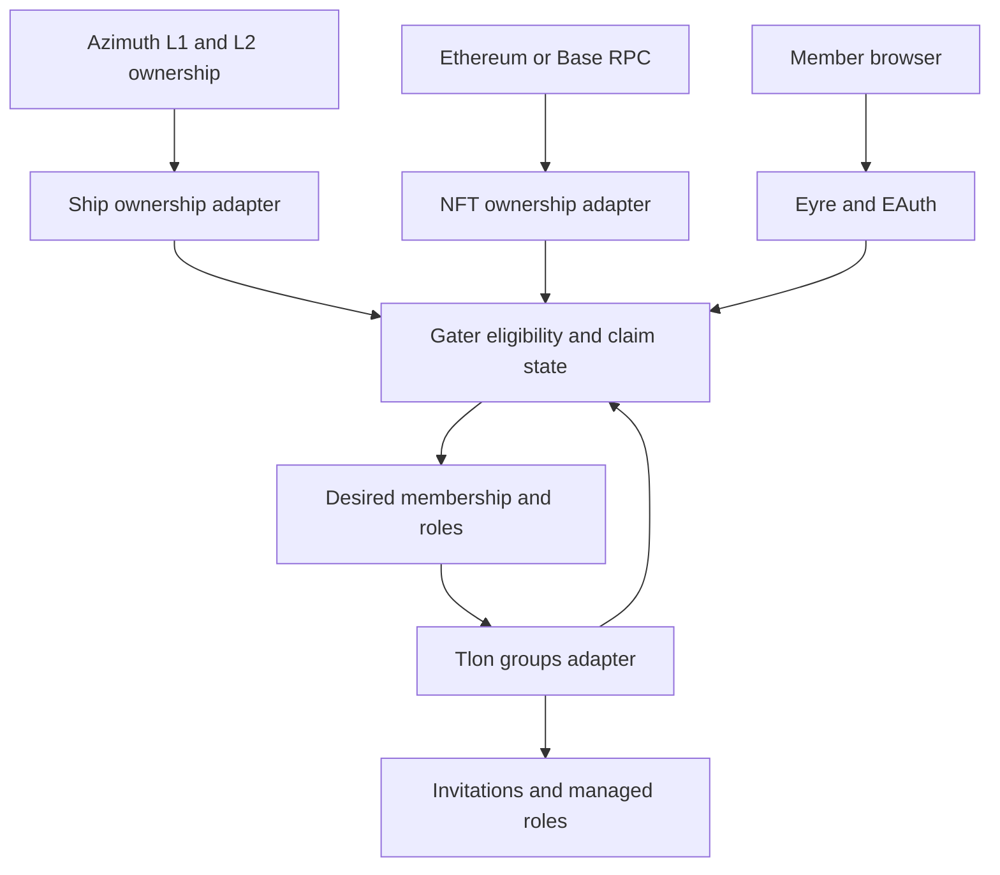

# Gater architecture

This is the proposed design as of 2026-10-25. Policies awaiting confirmation are collected in [decisions.md](decisions.md).

## System boundary

The MVP runs on the same ship that hosts the managed Tlon group. It supports multiple configured ERC-721 collections and groups, initially exercising one collection and one group. Ethereum mainnet uses chain ID `1`; Base mainnet uses `8453`. Azimuth L2 is its own ownership system derived from Ethereum and is distinct from Base.



Gater performs reads against chain state; associating an NFT with a ship is an application-state operation. It does not transfer NFTs or require a new smart contract. The group host remains the authority over its group and can override its own agent.

## Eligibility and association

Use the effective **owner** address, not a management, spawning, voting, transfer proxy, or token approval. Limit initial eligibility to Azimuth points: galaxies, stars, and planets. Moons and comets need a separate delegation policy and are outside the MVP.

For ship `s` and collection `c`:

```text
invite_eligible(s, c) =
    ownership_sources_are_ready
    AND effective_azimuth_owner(s) is a valid nonzero address
    AND collection_balance(c, effective_azimuth_owner(s)) > 0

claim_eligible(s, token) =
    authenticated_ship == s
    AND s is a member of the relevant managed group
    AND token belongs to an allowed collection
    AND effective_azimuth_owner(s) == nft_owner(token)
    AND both ownership observations satisfy the source policy
```

A token key is `(chain_id, contract_address, token_id)`. Use full-width integers for token IDs and decimal strings at the JSON boundary. Never infer the chain or collection from a token number or display name.

Store two indexes atomically: `token -> claim` and `(collection, ship) -> token`. The collection key includes chain ID and contract. Within one host, all managed groups consume the same association for that collection. A ship may have separate associations for different collections. This is a proposed interpretation of one-to-one mapping, not a global registry.

For multi-collection groups, invite eligibility is the union of configured qualifying holdings. Role eligibility is the union of active claims mapped to each role. Losing one claim must not remove a role still justified by another claim.

## Admission and permissions

Separate three states: eligible for an invitation, admitted as a member, and entitled to an NFT role. Invitations do not reserve an NFT or grant its role.

The default proposal is a social lobby plus role-restricted channels. Multiple ships at one address can join the lobby; only the associated ship gets the NFT role. Keeping a member after an NFT sale means they retain access to any channels open to ordinary members. Administrators must configure channel readers accordingly.

Membership loss is configurable at the group level:

| Policy | After confirmed loss |
| --- | --- |
| Retain members, proposed default | Remove unsupported managed roles; retain membership |
| Require any qualifying holding | Remove managed members when their owner holds no qualifying NFT |
| Require an active claim | Remove managed members without a claim after a joining grace period; later extension |

An enforced membership gate needs private/secret admission and control over alternate entry paths. A public group or unrestricted invitation token can let an otherwise ineligible ship rejoin. Validate group privacy and token policy during setup. Admission changes remain subject to the ownership detection delay; ordinary Tlon admission is not an atomic on-chain check.

Never automatically remove the host, protected administrators, or members outside the configured management scope. Tlon may reject removal of channel hosts; report this for operator resolution rather than claiming enforcement succeeded.

Track invitations by group, ship, and eligibility generation. Rate-limit initial discovery and retries, honor bans, and suppress re-invitation after a user leaves or an administrator removes them. Allow an explicit rejoin request or operator reset. On loss of eligibility, revoke Gater-owned pending admission/invitation state; do not delete unrelated manual invitations. Do not assume an already-delivered notification can be erased.

## Claims and reassignment

Initial claims use EAuth and a fresh ownership check. A user selects an unclaimed token; they do not submit an authoritative wallet or ship identity. The backend derives identity from Eyre and ownership from the adapters.

Proposed conflict policy, pending the user's choice:

- An authenticated eligible ship can claim an unassociated token.
- The currently associated ship can release its claim or nominate another eligible ship at the same owner address. The destination authenticates before activation.
- A different ship cannot silently replace an active association. It needs release by the current ship or a narrowly scoped signature from the current wallet owner.
- The host can suspend a claim, with an audit reason. It cannot make a non-owner token pass the normal eligibility check.

EAuth establishes ship control, not wallet-key possession. The initial-claim rule intentionally delegates some authority to the ship operator. If that is too broad for hosted ships, enable wallet signatures for every claim instead. Signature support must specify domain, host, action, token, destination ship, expected claim revision, nonce, and expiry; consume the nonce once and validate ownership again. Contract-wallet verification needs a separate chain-aware design before it is supported.

Two concurrent attempts use a claim revision and expected previous association. Gall serializes the state updates, but RPC and group actions are asynchronous: bind each response to the request and source generation, and reject stale results. A conflict returns the current association rather than overwriting it.

Reassignment is atomic in Gater's indexes; Tlon side effects are not atomic with it. Put the claim into a moving state, remove the old entitlement, verify the old managed role is absent where it is no longer justified, then activate and grant the destination entitlement. If removal fails, keep the new grant pending. A restart resumes the durable operation. This favors a temporary gap over duplicate access caused by the move.

## Ownership changes and freshness

NFT transfers and burns, Azimuth owner changes, and point continuity changes invalidate affected claims and pending authorizations. Track an ownership generation so transferring an asset away and back cannot silently revive an old claim. A fresh eligible owner can create a new claim. The same rule applies if both assets move to a new owner together.

Ownership observations are a pair of independently advancing chain/source checkpoints, not a single cross-chain transaction. There is an unavoidable detection and finality delay. Revalidate at claim acceptance and immediately before dispatching a new grant; continue reconciliation afterward.

For NFT reads, start with finalized blocks where the provider supports them. Keep a separate discovery view if faster previews are useful. An Ethereum block count is not a substitute for Base finality. Surface the last processed height, hash, observation time, and policy in the admin view. See [Base's derivation specification](https://docs.base.org/base-chain/specs/protocol/consensus/derivation).

Do not label current `%azimuth` scries as finalized ownership. Phase 0 must establish completeness, freshness, and the relationship between processed state and an Ethereum checkpoint. If those cannot be established, strict mode needs an independent finalized replay using Urbit's existing Azimuth libraries or a source providing an equivalent verifiable snapshot. A provisional source cannot issue strict-mode grants.

When RPC or ownership sources are stale, freeze new invitations, claims, reassignments, and grants. Retain existing memberships and roles by default, mark them unverified, and alert the host; a missing response is not evidence of a sale. Resume changes after resynchronization. Groups needing automatic suspension after prolonged outages can add that explicit policy later.

The MVP trusts the configured RPC provider for canonical chain data and complete responses. Hash/checkpoint checks detect inconsistencies but do not make a single-provider reader trustless. Host downtime also delays enforcement; expose this operational limit alongside source health.

## Durable state and reconciliation

| Record | Important fields |
| --- | --- |
| Group policy | Group flag, collections, managed role IDs, membership policy, protected ships, enabled/dry-run |
| Collection | Chain, contract, standard, deployment block, discovery method, provider reference |
| Source checkpoint | Height, hash, processed-through boundary, freshness, completeness, source generation |
| Ownership indexes | Token-to-owner, owner-to-tokens, point-to-owner, owner-to-points |
| Claim | Token key, ship, owner, revision, ownership generations, source checkpoints, status |
| Invitation ledger | Eligibility generation, pending/sent/suppressed status, last attempt, provenance |
| Effect outbox | Desired revision, group, ship, role/action, retry state, observed result |
| Audit entry | Actor, reason, previous/new association, evidence, operation result |

Version persistent state from the first runnable desk and test migrations. Apply chain batches together with their cursor; a crash must not advance the cursor without applying the ownership changes.

Recompute desired state when either ownership source, group membership, policy, or a claim changes. Compare it with observed Tlon state and issue only necessary actions. Persist the outbox before dispatch, retry with backoff, and reread after uncertain outcomes. A poke acknowledgment alone does not establish the intended group state.

Use dedicated managed role IDs. Gater only edits those roles and leaves unrelated roles intact. If a human wants an exception to a managed role, store that exception in Gater; Tlon's role set alone does not identify who granted it. Pause an incompatible or deleted group/role configuration rather than continuously recreating it.

## HTTP boundary

Serve the member page directly through Eyre under `/gater`; begin with Sail and small local assets. The public entry page contains a sign-in form. After EAuth, require the authenticated-request flag and derive the actor from `src.bowl`; never trust a submitted ship name. Keep host administration separate from member operations. The standard Landscape launcher is not the foreign member entry point. [EAuth documentation](https://docs.urbit.org/urbit-os/kernel/eyre/eauth).

Proposed routes are `GET /gater`, `GET /gater/api/me`, and POST operations for claim, release, and move. Admin configuration and dry-run results are host-only. Check CSRF tokens and request origin for mutations, bound payload sizes, rate-limit attempts, and serve private responses without shared caching. Recheck authorization on direct Gall actions as well as HTTP routes.

Invalidate application authorizations after owner or continuity changes. The EAuth spike must test whether old Eyre sessions can be invalidated or freshness can be established; if not, require a new independently verified authorization for sensitive changes. A browser refresh alone is not fresh authentication.

RPC credentials stay server-side. Redact endpoint URLs and auth headers from logs and diagnostics. Treat wallet/ship correlations and claim history as host data; expose only what a member needs. Avoid rendering remote NFT HTML/SVG or fetching arbitrary token metadata URLs in the MVP. Display collection name and token ID first.
